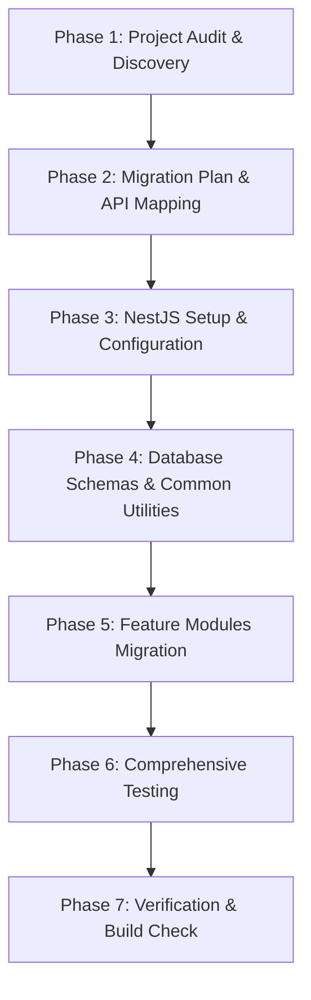

# Backend Migration Plan: Next.js to NestJS + MongoDB

## 1. Migration Strategy Overview

This document defines the architectural migration plan for extracting all backend capabilities from the existing Next.js application (`stackfyra-website`) into a standalone, production-ready NestJS application (`backend-nestjs`).

### Core Tenets
1. **Zero Impact on Existing Project**: `stackfyra-website` is strictly read-only. No file is edited, moved, renamed, or deleted.
2. **Schema & Data Preservation**: Exact Mongoose collection names, field names, data types, indexes, and constraints are preserved.
3. **API Contract Compatibility**: All existing API routes, HTTP verbs, request payloads, response schemas, and status codes are preserved.
4. **Security & Authentication Parity**: `@stackfyra.com` email domain validation, bcrypt salt rounds, JWT secret and token payload format (`userId`, `email`, `role`), cookie name (`stackfyra_session`), and bearer token extraction are preserved.
5. **Robust Integrations**: Meta Lead Ads Webhook signature verification, Graph API communication, Resend durable email outbox, and Firebase Cloud Messaging (FCM) push notification capabilities are fully reproduced.

---

## 2. Implementation Phases

### Phase 1: Project Audit & Discovery (Completed)
- Analyzed Next.js dependencies, models, routes, and services.
- Confirmed zero server actions (`'use server'`).
- Documented all 35 API routes and 8 Mongoose database schemas.

### Phase 2: Migration Plan & API Mapping (In Progress)
- Create all required documentation in `backend-nestjs/docs/`.
- Establish target module boundaries in NestJS.

### Phase 3: NestJS Setup & Configuration
- Scaffolding `backend-nestjs` with modern NestJS architecture.
- Install Mongoose, Swagger, ConfigModule, ScheduleModule, JwtModule, Passport, Class-Validator, Resend, and Firebase Admin SDK.
- Configure global prefix `api`, Swagger documentation at `/api/docs`, validation pipes, exception filters, and CORS.

### Phase 4: Database Schemas & Common Utilities
- Create Mongoose schemas matching existing collections:
  - `FormSubmission`
  - `User`
  - `PasswordResetOtp`
  - `Lead`
  - `MetaIntegration`
  - `MetaWebhookEvent`
  - `EmailIntegration`
  - `EmailOutbox`
- Implement common utilities:
  - AES-256-GCM encryption/decryption (`encryption.util.ts`)
  - Meta HMAC-SHA256 signature verification (`signature.util.ts`)
  - Email domain validator (`email-validator.util.ts`)
  - Guards, Decorators, and Interceptors

### Phase 5: Feature Modules Migration
1. **AuthModule**:
   - Controller (`/api/auth/*`): login, register, me, logout, forgot-password, verify-reset-otp, reset-password.
   - JWT strategy, cookie extractor, bcrypt password verification, OTP generation/validation.
2. **InquiriesModule**:
   - Controller (`/api/send-inquiry`): input validation DTO, FormSubmission creation, email and push dispatching.
3. **AdminSubmissionsModule**:
   - Controller (`/api/admin/submissions/*`): search, pagination, status aggregation, CSV generation, update, delete.
4. **AdminUsersModule**:
   - Controller (`/api/admin/users/*`): pagination, creation, profile update, role update, status toggling with safety guards.
5. **NotificationsModule**:
   - Controller (`/api/admin/fcm-token`): device token registration.
   - Service: Firebase Admin SDK initialization, multicast dispatch, token cleanup.
6. **CrmModule**:
   - Controller (`/api/crm/leads/*`): tenant-isolated search, pagination, filtering, CSV export, update, deletion.
7. **EmailModule**:
   - Centralized Resend client with pooling, Outbox job queueing, status tracking, bounded exponential backoff retry scheduler.
   - Branded HTML email templates for all notification types.
8. **MetaModule**:
   - Controller (`/api/meta/*`): pages, forms, connect, disconnect, status, sync.
   - Graph API client (`v26.0`), token inspection, page subscription, automated 60-minute scheduler.
9. **IntegrationsModule**:
   - Controller (`/api/admin/integrations/*`): Meta validate, token, status, reauthorize; Email validate, test, status, retry, jobs, configure.
10. **WebhooksModule**:
    - Controller (`/api/webhooks/meta`, `/api/webhooks/resend`): Meta challenge handshake (GET) and HMAC-SHA256 event receiver (POST); Resend delivery event receiver (POST).

### Phase 6: Comprehensive Testing
- Unit tests for services and validators.
- Integration tests for controllers and DTO validation.
- End-to-end API verification.

### Phase 7: Verification & Build Check
- Verify that `backend-nestjs` builds with zero errors.
- Confirm that `stackfyra-website` remains 100% untouched.
